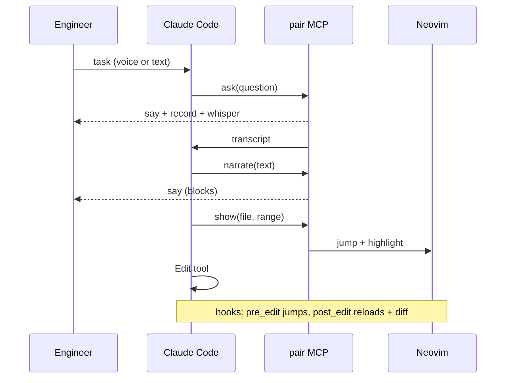
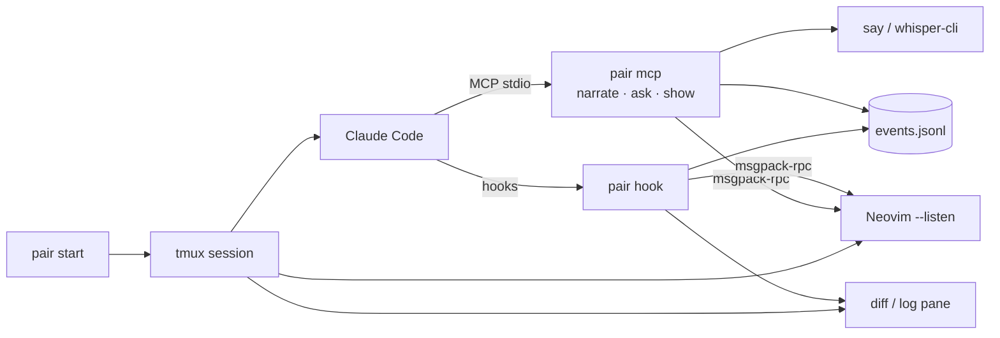

# PRD: pair — voice-driven pairing for Claude Code in the terminal

Sep 24, 2026 · @Fábio Araújo · Rev 2 (Sep 25, 2026): amended after the validation fan-out, see `VALIDATION.md`

## Overview

`pair` turns a Claude Code session into a spoken pairing session: Claude explains what it is about to do out loud, points at code in Neovim, asks questions and listens for the answer, while the engineer watches edits land live and can interrupt at any time.

**Problem.** Claude Code is a great executor but a silent one. Working with it feels like reviewing a pull request, not like pairing. Explanation lives in a scrolling text log, there is no pointing ("look at this line"), no live view of the files being edited, and every question requires typing.

**Approach.** Do not wrap or fork Claude Code. Orchestrate around it with pieces that already exist: tmux for layout, Claude Code hooks and MCP tools for events, Neovim's remote API for the live view, macOS `say` for speech and whisper.cpp for local speech-to-text. Everything runs locally, offline, and free.

**Why terminal-native.** It is the real Claude Code session with the user's real config and permissions, it works over SSH, and the engineer can take over in Neovim at any moment, which is closer to real pairing than a read-only web view.

**Non-goals for the project.** Real-time speech-to-speech with sub-second latency, a GUI, or replacing the human side of pairing (shared ownership, team knowledge).

## Goals and non-goals (v1)

v1 ships the full loop: narrate, show, ask, listen, interrupt, scratchpad and diff awareness, as an open-source tool another engineer can install in under 10 minutes.

**Goals**

1. Claude speaks a short rationale before every file edit and pauses until it has finished speaking.
2. Claude can point at a file range in Neovim without editing it.
3. Claude can ask a question aloud and receive the spoken answer as the tool result, within the same turn.
4. The engineer can talk to Claude (push-to-talk) and interrupt it mid-task with one hotkey.
5. Every edit is visible live in Neovim, with a diff view.
6. A shared scratchpad file (`PAIRING.md`) holds the plan, decisions and open questions; both sides edit it.
7. Claude is aware of edits the engineer made by hand since the last prompt.
8. Every event is logged as JSONL so a session can be replayed later.
9. One-command install and one-command session start.

**Non-goals**

- Sub-second voice latency or overlapping speech.
- Editors other than Neovim (VS Code and Zed are future work).
- Operating systems other than macOS (Linux TTS/STT is future work).
- Cloud TTS/STT by default. Providers must be swappable, but the default is free and local.
- Modifying Claude Code itself.

## Target users and prerequisites

The user is an engineer who already lives in Claude Code and Neovim on macOS and wants sessions to feel like pairing rather than delegating.

**Prerequisites**

| Dependency | Why | Install |
| --- | --- | --- |
| macOS 14+ (Apple Silicon recommended) | `say`, `afplay`, whisper.cpp Metal | — |
| Claude Code | the agent | `npm i -g @anthropic-ai/claude-code` |
| tmux 3.x | layout and pane control | `brew install tmux` |
| Neovim 0.10+ | live view via `--listen` | `brew install neovim` |
| whisper.cpp + a model | local STT | `brew install whisper.cpp` (formula renamed; `whisper-cpp` still resolves). Installs `whisper-cli`; no model included |
| sox | mic recording with silence detection | `brew install sox` |
| git-delta (optional) | pretty diffs | `brew install git-delta` |
| Hammerspoon (optional) | global hotkeys | `brew install --cask hammerspoon` |

No language runtime is required: `pair` is a single static Go binary (CLI, MCP server and hook handler in one). macOS ships no `timeout(1)`; every cap in this document is a Go context deadline, never a shell `timeout`.

Implementation language: Go. One binary, no runtime to install, sub-10 ms startup for hooks that fire on every edit (measured 4–6 ms end to end), and pre-built binaries published to a Homebrew tap via goreleaser. The official MCP Go SDK (`github.com/modelcontextprotocol/go-sdk`) provides the stdio server.

## Session experience

A session starts with `pair` in a repo, and from then on the engineer mostly talks and watches.

1. `pair` opens tmux: Claude Code on the left, Neovim (file tree + editor + `PAIRING.md`) top right, diff/narration log bottom right.
2. The engineer speaks or types the task. Push-to-talk transcribes and sends it to the Claude pane.
3. Claude writes the plan and open questions to `PAIRING.md` before touching code.
4. For each decision point, Claude calls `ask`: the question is spoken, a chime plays, the mic records until silence, the transcript returns to Claude.
5. Before each edit, Claude calls `narrate` (spoken, blocking) and optionally `show` to highlight the range it is about to change.
6. The edit lands; Neovim reloads the file and the diff pane updates.
7. At any point the engineer presses the interrupt hotkey: speech stops, Claude Code receives Escape, push-to-talk opens.
8. The engineer can edit in Neovim directly; the next prompt automatically carries the resulting `git diff`.
9. Claude updates `PAIRING.md` with decisions taken. The JSONL log captures everything for replay.



Claude waits on every spoken step, so pacing comes from the blocking calls rather than from timers.

## Architecture

Five processes, one event log, no daemon: Claude Code is the only long-running agent, and everything else reacts to it through hooks, MCP tool calls and Neovim's socket.



**Rev 3 (Sep 28, 2026), after the first real session.** The layout below was replaced: watching Claude Code's own output is not the point of pairing; what matters is whether it is running, which files it changes and why. Neovim (project tree, editor, `PAIRING.md`) is now the main area, the activity log is the right column, and Claude Code is a strip under the editor (`F7` zooms it). The status bar shows the state (working, speaking, asking, listening, your turn, needs you). Speech is announced by an attention sound, because a sentence that starts unannounced after a long quiet stretch is half missed. `F5`/`F6` talk and interrupt from any pane. The session runs on pair's own tmux server (`tmux -L pair`) and panes are addressed by id, not index. Settings persist in `~/.pair/config`. Two rules fixed by the engineer after that session: (1) Neovim stays the stage, and a change is pointed at inside the real file (added lines highlighted, removed lines shown in place), not in a separate diff view; (2) the microphone is closed by default and only an explicit key press or click opens it, including for answers to `ask`, which now waits for the engineer's push-to-talk (`PAIR_ASK_MIC=manual`). An open microphone with voice activity detection and barge-in is out of scope. Further refinements from use: Claude Code's strip is eight lines and grows only while a permission prompt waits; the activity column is a conversation view (`pair log --follow`) instead of a raw tail, showing edit cards rather than diff bodies since the change is drawn in the editor; a `PreToolUse` hook on every tool keeps the status bar saying what Claude is doing; Neovim gets a colourful built-in theme when the engineer has no configuration. Then: Claude Code's pane is hidden completely (it runs in a background tmux window) and `F7` or the `claude` button toggles it under the editor; it opens by itself only while a permission prompt waits. An animated presence panel (`pair presence`, ten frames a second, one motion and colour per state, elapsed timer) sits above the activity column, and the pane borders take the colour of the state. Sessions are kept apart: each `pair` starts a new one with a clean activity column and a new Claude Code conversation, the previous one moves to `.pair/sessions/<id>/`; sessions can be named, listed (`pair sessions`), read, replayed, and opened again (`pair --continue`, `pair resume <id or name>`), which resumes the exact Claude Code conversation recorded by the hooks. Hooks and MCP tools act only inside a pair session (`PAIR_ACTIVE`), so a Claude Code started otherwise in the same repository leaves the session alone.

**Original tmux layout** (session name `pair`, window 0):

| Pane | Content | Size |
| --- | --- | --- |
| 0 (left) | `claude` interactive | 50% width |
| 1 (top right) | `nvim --listen $PAIR_SOCK` with file tree, editor, `PAIRING.md` split | 70% height |
| 2 (bottom right) | `tail -f` of the narration log, rendered diffs via `delta` | 30% height |

**Data flow**

- Claude to screen: MCP `show` and the `PreToolUse` hook drive Neovim over msgpack-rpc (`ExecLua` into `pair.nvim`), always with absolute file paths. Fallback is `nvim --server $PAIR_SOCK --remote-expr "luaeval(...)"`, never `--remote-send` (it types keystrokes: in insert mode the command lands in the buffer, with a pending operator it deletes lines).
- Claude to ears: MCP `narrate` and `ask` run `say` synchronously.
- Ears to Claude: `ask` records with `rec`, transcribes with `whisper-cli`, returns text; push-to-talk does the same and injects via `tmux send-keys -t pair:0.0 -l -- "$text"` followed by a separate `tmux send-keys -t pair:0.0 Enter` (literal mode so key names and leading dashes in a transcript are not interpreted).
- Engineer edits to Claude: the `UserPromptSubmit` hook prepends `git diff` (bounded) to the prompt context.
- All of the above append one JSON line to `.pair/events.jsonl` per event: `{ts, type, payload}`.

**Runtime state** lives in `.pair/` inside the repo: `events.jsonl`, `session.log` (the pane 2 tail), `PAIRING.md` (or at repo root; see open questions), `last_input.wav`. The Neovim socket does not live there: macOS limits unix socket paths to 104 bytes and `nvim --listen` refuses longer ones, so the default is `$TMPDIR/pair-<hash of repo root>.sock` (or `127.0.0.1:<port>`).

## Component specs

Six components, each small enough to build and test on its own.

### 1. `pair` CLI

- `pair` (or `pair start`): create the tmux session with the three panes (`split-window -h -l 50%`, then `split-window -v -l 30% -t pair:0.1`), start `nvim --listen`, start `claude` with `CLAUDE_CODE_MCP_AUTO_BACKGROUND_MS=0`, open `PAIRING.md`. Idempotent: `has-session` then attach. Must cope with Claude Code's workspace-trust dialog in a fresh repo (its default answer is "No, exit").
- `pair init`: write `.claude/settings.json` hooks + permissions, register the MCP server with the absolute binary path from `os.Executable()` (a relative or missing path surfaces as a misleading `ENOENT … posix_spawn 'stdio'`), create `PAIRING.md` from a template, append the pairing-mode block to `CLAUDE.md` (guarded by markers so it can be updated or removed).
- `pair doctor`: check every dependency, the whisper model, the socket path length, `say` voice availability (report that stock Luciana is the basic voice and point to "Luciana (Enhanced)" under Manage Voices; no Premium/Siri pt-BR voice is exposed to `say`), mic permission (one 1 s `rec … trim 0 1` with a 10 s SIGTERM cap; if no file appears, print the Microphone privacy-settings instructions and `tccutil reset Microphone <bundle>`), ambient noise (warn when RMS exceeds the 1 % silence threshold, since recording would never stop), and a one-turn `narrate` probe, because Claude Code 2.1.282 defers MCP tool schemas and only loads them through `ToolSearch`.
- `pair replay [events.jsonl]`: replay a session (narration + jumps) at 1x or faster. Nice-to-have for v1.
- `pair stop`: kill the session and any running `say`/`rec`.

### 2. `pair mcp` (stdio MCP server, Go, official MCP Go SDK)

| Tool | Input | Behaviour | Returns |
| --- | --- | --- | --- |
| `narrate` | `text` | Log event, run `say` synchronously (blocks) | `"spoken"` |
| `ask` | `question` | `say` the question, play chime, `rec` until 1.5 s silence (max 60 s), `whisper-cli`, log both | transcript or `"(no answer)"` |
| `show` | `file`, `start_line`, `end_line?`, `note?` | Jump Neovim to the range, highlight it, optionally `narrate(note)` | `"shown"` |

Rules:

- Never record while `say` is running (echo). Calls are sequential by design; a mutex guards against parallel tool calls anyway.
- `narrate` and `ask` reject text over ~400 characters with a message telling Claude to shorten it. The cap is a ceiling, not the pacing guard: in validation no narration exceeded 317 characters, yet the average was 199 and speech added 45–57 % to wall time. Pacing comes from the prompt's length target (aim under 200 characters); both tool descriptions state "max 400, aim under 200" because Claude Code loads MCP schemas lazily and the description is what the model reads.
- Voice, rate, language and model come from `PAIR_VOICE`, `PAIR_RATE`, `PAIR_LANG`, `PAIR_WHISPER_MODEL`.
- Cancellation contract (verified): when the engineer presses Escape, Claude Code sends `notifications/cancelled` and the handler's `ctx` is cancelled within ~100 ms, but the server process and any child it spawned survive and a late result is discarded. Every tool selects on `ctx.Done()` and kills `say` / `rec` / `whisper-cli` itself, with SIGTERM (a SIGTERM'd `rec` leaves a valid WAV; SIGKILL leaves a broken header that whisper hallucinates on).
- "(no answer)" is decided from the audio, never from the transcript: whisper returns text for silence ("Obrigado.", "Transcrição e Legendas por…", lone "."). `ask` returns "(no answer)" when `rec` produced no file, the recording is under 0.3 s or below the RMS threshold, or the `PAIR_ASK_MAX` cap fired, and additionally drops transcripts matching a small hallucination blocklist (Obrigado, Legendas, Transcrição, Amara.org, Tchau, lone punctuation). Whisper stdout is trimmed (leading blank line and space); `-np` still writes ~40 ggml/Metal lines to stderr, which are ignored.
- `Speaker` and `Listener` Go interfaces with `SayTTS` and `WhisperCPP` as default implementations, so cloud TTS/STT can be dropped in later.
- Registered with `claude mcp add pair -- pair mcp`; the same binary serves hooks and CLI.

### 3. Claude Code hooks (`.claude/settings.json`)

| Hook | Matcher | Command | Does |
| --- | --- | --- | --- |
| `PreToolUse` | `Edit\|Write` | `pair hook pre_edit` | Parse `tool_input` (`file_path`, `old_string`, `new_string`, `replace_all` for Edit; `file_path`, `content` for Write; `cwd` is also on stdin), locate the `old_string` line, jump + highlight in Neovim, log. No audio (narration is the MCP tool's job). `MultiEdit` no longer exists in Claude Code 2.1.x; a multi-edit change arrives as N consecutive `Edit` events. |
| `PostToolUse` | `Edit\|Write` | `pair hook post_edit` | `:checktime` in Neovim (safe only with the `FileChangedShell` autocmd below; otherwise a buffer with unsaved edits opens a modal dialog and the RPC blocks until the hook times out), render the diff through `delta` into the log pane, log. `tool_response` carries `filePath`, `structuredPatch`, `originalFile` (camelCase), so the diff can come straight from the hook input. |
| `UserPromptSubmit` | — | `pair hook prompt` | If `git diff` (working tree, bounded to ~200 lines) is non-empty since the last prompt, emit it as `hookSpecificOutput.additionalContext` prefixed "Engineer changed since last turn:". Default timeout for this event is 30 s and timed-out output is discarded silently; exit code 2 erases the user's prompt, so the hook always exits 0. |
| `Stop` | — | `pair hook stop` | Chime + log turn end. |

Hooks read JSON on stdin, must exit 0, and finish in well under the hook timeout (600 s default for command hooks, 30 s for `UserPromptSubmit`; `pair init` sets an explicit `timeout` anyway). They are subcommands of the same binary (`pair hook pre_edit`), so startup cost is negligible and there is one place to test. `pair init` writes the absolute binary path into the hook commands.

### 4. Neovim integration (`pair.nvim`, Lua)

- Highlight group and namespace for "Claude is pointing here"; highlight clears on the next `show`, on edit, or after `PAIR_HIGHLIGHT_TTL` seconds.
- Exposes Lua functions `require('pair').show(file, s, e)` and `require('pair').reload()` so the Go binary drives the editor with one `nvim_exec_lua` call over msgpack-rpc instead of composing keystrokes.
- `autoread` + `checktime` on focus and on hook signal, plus a `FileChangedShell` autocmd: when the buffer is unmodified set `v:fcs_choice = 'reload'`; on a conflict (unsaved local edits) set it to `''` and `vim.notify` one line instead of the modal `[O]K, (L)oad File` dialog that would block the RPC.
- Go side uses only `Dial`, `ExecLua`, `Command` and `Close` from `neovim/go-client` (22 of its 151 wrappers call API removed or deprecated in Neovim 0.12; the client's last release is v1.2.1 from 2022) and wraps every call in a deadline, since the client has no per-call context. Everything else is Lua.
- Keymap `<leader>pp` (visual): send `file:start-end` + optional typed note to the Claude pane via `tmux send-keys`.
- Keymap `<leader>pt`: push-to-talk (`pair hook listen`).
- Keymap `<leader>pi`: interrupt (`pair hook interrupt`: kill `say`, `tmux send-keys -t pair:0.0 Escape`, wait ~0.3 s for the prompt to come back, then listen). Escape, never `C-c`: a single `C-c` also interrupts but two in a row exit Claude Code.
- Command `:PairScratch` toggles the `PAIRING.md` split.
- Ships as a plugin directory usable with lazy.nvim; `pair init` prints the snippet.

### 5. Scratchpad (`PAIRING.md`)

Template sections: `Task`, `Plan`, `Decisions`, `Open questions`, `Notes`. `CLAUDE.md` instructs Claude to write the plan there before coding and to append to `Decisions` after every `ask`. Diagrams are ASCII or Mermaid fenced blocks. The file is git-ignored by default (`pair init` adds it), overridable.

### 6. Push-to-talk / interrupt (Hammerspoon, optional)

Global hotkeys that work even when the terminal is not focused: hold-to-record, and interrupt. They call the same `pair hook listen` / `pair hook interrupt` subcommands the Neovim keymaps use, so behaviour is identical.

## Voice

Default stack is macOS `say` for output and whisper.cpp for input: free, offline, and good enough for Portuguese with English technical terms.

**TTS (`say`)**

- Default voice `Luciana` (pt-BR), rate 190 (measured 14.7–15.8 chars/s, about 150 effective wpm; use 15 chars/s for pacing estimates). `pair doctor` warns if the voice is missing and points to System Settings → Accessibility → Spoken Content → Manage Voices to download "Luciana (Enhanced)"; the stock voice is the basic quality tier.
- All speech goes through one `Speaker#speak(text)` call so it can be killed (`pkill say`) on interrupt and so a mutex can serialize it.
- Text is normalized before speaking: strip markdown, backticks and code; expand common abbreviations (`PR`, `DB`, `ActiveRecord`) via a small dictionary so they are not spelled letter by letter.

**STT (whisper.cpp)**

- Default model `ggml-large-v3-turbo` (about 1.6 GB); `pair doctor` offers to download it to `~/.pair/models/`. `small` as a low-end fallback.
- Recording: `rec -q -r 16000 -c 1 <wav> silence 1 0.1 1% 1 1.5 1%` with a hard cap enforced by a Go context deadline and SIGTERM (`PAIR_ASK_MAX`, default 60 s). The effect trims leading silence and stops at the first pause of at least 1.5 s; a 1.0 s pause does not stop it (verified offline with sox). Silence threshold and trailing silence are configurable.
- Transcription: `whisper-cli -m <model> -l $PAIR_LANG -nt -np --prompt "<vocab>" -f <wav>`. On an M5 Pro, large-v3-turbo transcribes 11 s of Portuguese in 0.83 s wall (RTF 0.074, Metal), of which model load is ~345 ms. The vocabulary prompt is built from a default Rails list plus `.pair/vocab.txt` in the repo; it fixed "Sidekiq" and "model" in validation but not "Hotwire" (→ "Twitter") or "migration" (→ "migração"), so the transcript is always shown in the log pane.
- Test fixtures come from `say -v Luciana --file-format=WAVE --data-format=LEI16@16000 -o x.wav`, which yields 16 kHz mono directly; no sox needed in tests.
- "(no answer)" is decided from the audio (no file, under 0.3 s, RMS below threshold, cap fired) plus a hallucination blocklist, because whisper never returns an empty transcript for silence (see Component 2).

**Provider interface**

```go
type Speaker interface {
    Speak(ctx context.Context, text string) error // blocks until done; ctx cancel = interrupt
}

type Listener interface {
    Listen(ctx context.Context) (string, error) // records until silence, returns transcript
}
```

Adapters planned after v1: OpenAI TTS/STT, ElevenLabs, Apple SpeechAnalyzer (macOS 26+). Selection by `PAIR_TTS` / `PAIR_STT` env vars.

## Configuration and pairing-mode prompt

Configuration is env vars with sane defaults, plus a `CLAUDE.md` block that `pair init` manages.

| Variable | Default | Meaning |
| --- | --- | --- |
| `PAIR_VOICE` | `Samantha` | `say` voice (rev 3: English by default; `pair init --lang pt --voice Luciana` for Portuguese) |
| `PAIR_RATE` | `190` | words per minute |
| `PAIR_LANG` | `en` | whisper language and the language line of the `CLAUDE.md` block |
| `PAIR_CUE` | `on` | attention sound before speech (rev 3) |
| `PAIR_WHISPER_MODEL` | `~/.pair/models/ggml-large-v3-turbo.bin` | model path |
| `PAIR_SOCK` | `$TMPDIR/pair-<repo hash>.sock` | Neovim listen address; must be ≤ 104 bytes on macOS (or `127.0.0.1:<port>`) |
| `PAIR_SESSION` | `pair` | tmux session name |
| `PAIR_HIGHLIGHT_TTL` | `20` | seconds before a `show` highlight clears |
| `PAIR_DIFF_LIMIT` | `200` | max diff lines injected by the prompt hook |
| `PAIR_ASK_MAX` | `60` | seconds of recording before `ask` gives up |
| `CLAUDE_CODE_MCP_AUTO_BACKGROUND_MS` | `0` | exported by `pair start`; disables Claude Code's 2-minute auto-backgrounding of MCP calls so `narrate`/`ask` always block |

Timeouts: Claude Code's default `MCP_TOOL_TIMEOUT` is about 28 hours, and a stdio server that sends no notification for 30 minutes has its call aborted (an idle timeout, not a total), so no override is needed. Verified on 2.1.282: a main-conversation MCP call still running after two minutes is moved to a background "MCP task" and the model continues without the result, which breaks pacing; with `CLAUDE_CODE_MCP_AUTO_BACKGROUND_MS=0` a 150 s call stayed blocking. `pair start` exports it for the session (`CLAUDE_CODE_DISABLE_BACKGROUND_TASKS=1` is a documented but broader alternative). `PAIR_ASK_MAX` remains as a safety net.

`.claude/settings.json` written by `pair init`: the four hooks above, and `permissions.allow` for `mcp__pair__narrate`, `mcp__pair__ask`, `mcp__pair__show`.

**`CLAUDE.md` block** (between `<!-- pair:start -->` / `<!-- pair:end -->` markers):

```markdown
## Pairing mode
You are pairing live with an engineer. Rules:
- Before coding, write the plan and open questions to PAIRING.md.
- Before each change, call `narrate` with one or two short sentences (under about 200 characters, about 10 seconds of speech): what you're changing and why. Plain speech, no markdown, no code. One narration may cover several related edits to the files it names.
- Use `show` to point at code you're discussing before you change it.
- When a decision is ambiguous, call `ask` instead of guessing: one `ask` per decision point, recommended option first, under 200 characters. If several small questions come up, ask the most consequential and put the rest under Open questions with your default. Record the answer in PAIRING.md under Decisions.
- Push back when you see a better approach; use `ask` for it.
- Speak Portuguese. Keep technical terms in English. Write PAIRING.md in the same language you speak.
- Do not narrate trivial edits (imports, formatting); narrate intent, not diffs.
- End the turn with one `narrate` saying what changed and what to look at; typed summaries are never spoken.
```

The language line is templated from `PAIR_LANG` at `pair init` time.

## Installation, distribution, repo layout

Distribute as a Homebrew formula plus a Neovim plugin; `brew install` then `pair init` inside a repo is the whole setup.

```
pair/
  cmd/pair/main.go        # single binary: start, init, doctor, replay, stop, mcp, hook <name>
  internal/cli/           # tmux session, init templates, doctor checks
  internal/mcp/           # narrate, ask, show tools (MCP Go SDK, stdio)
  internal/hook/          # pre_edit, post_edit, prompt, stop, listen, interrupt
  internal/speech/        # Speaker/Listener interfaces, say + whisper.cpp impls, text normalizer
  internal/nvim/          # remote client (msgpack-rpc or --remote-send)
  internal/events/        # JSONL log + replay
  nvim/                   # pair.nvim (lua/pair/init.lua, plugin/pair.lua)
  templates/              # PAIRING.md, settings.json, CLAUDE.md block, hammerspoon init.lua
  .goreleaser.yaml        # darwin arm64/amd64 builds + Homebrew tap
  README.md
```

- License: MIT.
- Distribution: goreleaser builds darwin arm64/amd64 and publishes to a Homebrew tap (`brew install <owner>/tap/pair`) as a cask: goreleaser's `brews:` is deprecated since v2.10 in favour of `homebrew_casks:`, whose `dependencies: - formula:` maps to the cask DSL's `depends_on formula:`. Hard deps: `tmux`, `neovim`, `sox`, `whisper.cpp`. The cask DSL has no optional deps, so git-delta and Hammerspoon go in `caveats`. Unsigned binaries need notarization or a post-install hook that strips `com.apple.quarantine`. Snippet in `validation/item6-packaging.md`. `go install github.com/<owner>/pair/cmd/pair@latest` works as a fallback and yields a binary named `pair`.
- Neovim plugin installable from the same repo: lazy.nvim has no `rtp`/subdirectory spec key (maintainer: not planned), so the spec is `{ "<owner>/pair", config = function(p) vim.opt.rtp:append(p.dir .. "/nvim"); require("lazy.core.loader").packadd(p.dir .. "/nvim") end }`, or a separate `pair.nvim` repo, which is cleaner and the likely v1 choice.
- Neovim control: msgpack-rpc over the socket (`github.com/neovim/go-client/nvim`, `Dial` + `ExecLua`) for jumps and highlights, with `--remote-expr "luaeval(...)"` as the fallback. Both paths cost 4–6 ms per hook process (spawn-dominated); the RPC's real gains are typed results and independence from the editor mode.
- README covers: the 60-second demo (asciinema), install, first session, hotkeys, swapping voices, and how to add a TTS/STT adapter.
- Tests: `go test` for text normalization, diff bounding, hook JSON parsing; integration test that runs `pair mcp` over stdio with fake `say`/`rec`/`whisper-cli` binaries on `PATH`.

## Milestones

Build in the order that gives a usable session soonest; each milestone is demoable on its own.

| # | Milestone | Scope | Done when |
| --- | --- | --- | --- |
| 1 | Skeleton | `pair start`, tmux layout, `nvim --listen`, `pre_edit` jump + highlight, `post_edit` reload | Watching Claude edit a file, the cursor follows |
| 2 | Voice out | `pair mcp` with `narrate` + `show`, `CLAUDE.md` block, `pair init` | Claude explains each edit aloud and pauses |
| 3 | Voice in | `ask`, push-to-talk, interrupt hotkey, whisper setup in `pair doctor` | A full task done without typing |
| 4 | Shared context | `PAIRING.md` template + keymaps, `UserPromptSubmit` diff hook, `<leader>pp` pointing | Claude reacts to hand edits and writes decisions |
| 5 | Ship | JSONL log, `pair replay`, diff pane with `delta`, Homebrew formula, README + demo | A stranger installs it in 10 minutes |

Milestone 1 is roughly a day; 1–3 together are a usable v0 for personal use before any packaging work.

## Risks, open questions, future work

The main risk is pacing: too much narration makes the session slower than typing, and the prompt rules plus the 400-character cap are the only guard.

**Risks**

| Risk | Mitigation |
| --- | --- |
| Claude narrates too much or too little | Prompt length target (aim under 200 chars), `Stop` hook speech stats in the log to tune; the 400-char cap is only a ceiling |
| `ask` questions are long or stacked (validation: 178–308 chars, one run asked three in a row before coding) | One ask per decision point, recommended option first, rest to Open questions; same 400 cap |
| `say` voices sound robotic and put people off | Recommend "Luciana (Enhanced)" in `doctor`; adapters for cloud TTS |
| Whisper hallucinates on silence ("Obrigado.") | Decide "(no answer)" from the audio; hallucination blocklist |
| Whisper mistranscribes jargon | Vocabulary prompt + `.pair/vocab.txt`; show the transcript in the log pane so errors are visible |
| MCP call auto-backgrounded after 2 min, breaking pacing | `pair start` exports `CLAUDE_CODE_MCP_AUTO_BACKGROUND_MS=0`; `pair doctor` warns if the user's env overrides it |
| `UserPromptSubmit` hook exceeds its timeout | Output is discarded silently on timeout, so bound `git diff` work and set an explicit `timeout` |
| Claude Code hook or MCP API changes | Thin adapter layer; pin tested Claude Code version in README |
| `neovim/go-client` is low-activity (v1.2.1, 2022; 22/151 wrappers hit deprecated 0.12 API) | Use only `Dial`/`ExecLua`/`Command`/`Close`, everything else in Lua; `--remote-expr` fallback |
| Unix socket path over 104 bytes | Default socket in `$TMPDIR`; `doctor` checks the length |
| `checktime` blocks on a modal dialog when the buffer has unsaved edits | `FileChangedShell` autocmd in `pair.nvim`; per-call deadline in `internal/nvim` |
| Claude Code defers MCP tool schemas (`ToolSearch` turn before first use) | Searchable tool descriptions; `doctor` runs a one-turn `narrate` probe |
| Gatekeeper quarantines the unsigned binary | Notarize, or strip `com.apple.quarantine` in the cask's post-install hook |
| Mic permission for terminal apps | `pair doctor` triggers a 1 s test recording with a SIGTERM cap to prompt macOS once, and prints the privacy-settings path when no file appears |

**Open questions**

- [ ] `PAIRING.md` at repo root or inside `.pair/`? Root is more visible; `.pair/` is tidier.
- [x] Should `show` auto-narrate a default line ("olha aqui") when `note` is empty? No: in validation every `show` was followed within 0.7–2 s by a `narrate` or `ask`, so a spoken default would be redundant. A short tick sound at most.
- [x] Name: keep `pair`. No formula, cask, binary or man page named `pair` exists (Homebrew core and cask, PATH, `man -w`); `pairvoice` and `pairtty` are free fallbacks if searchability becomes a problem.

**Future work**

- Realtime speech-to-speech adapter (OpenAI Realtime / Gemini Live) for fluid conversation.
- MCP elicitation as a typed fallback for `ask` (the Claude Code CLI renders an inline form; the Desktop Code tab does not advertise elicitation, so it cannot be the only path).
- VS Code and Zed live views over the same event log.
- Linux support (Piper for TTS).
- Browser/app awareness via Playwright MCP so Claude can see what the engineer sees.
- Replay export as a narrated walkthrough for onboarding and PR explanations.

## Validation plan

Executed on Sep 24–25, 2026 on macOS 26.6.2 / Claude Code 2.1.282; results in `VALIDATION.md`, evidence in `validation/`. Verified: hook stdin shapes and `additionalContext`; the 2-minute auto-backgrounding and its env var; MCP Go SDK v1.8.0 API and Escape → `ctx` cancellation; `neovim/go-client` v1.2.1 `Dial` + `ExecLua` + extmarks; `say`, `rec`, `whisper-cli` flags and large-v3-turbo timing; the tmux layout and Escape handling; no name collision. Wrong and now amended: `MultiEdit`, `--remote-send`, `checktime` on unsaved buffers, the 104-byte socket path, `whisper-cpp` formula name, goreleaser `brews:`, lazy.nvim `rtp`, the "(no answer)" rule, the cap as pacing guard. Still uncertain: live microphone capture (blocked on a permission dialog in the unattended run). Practical notes for future runs: nested Claude Code sessions need `env -u CLAUDECODE` and `claude -p … < /dev/null`; Claude Code blocks a bare foreground `sleep` in Bash and may auto-background long shell commands, so blocking-call tests need an MCP tool or a wrapper script.

The original fan-out prompt is kept below for re-runs against newer Claude Code versions.

**Fan-out prompt for Claude Code**

```markdown
Read PRD.md. Spawn one subagent per item below, in parallel. Each subagent must
answer with: VERIFIED / WRONG / UNCERTAIN, evidence (command output or doc URL),
and the concrete change to the PRD if any. Do not build anything yet.

1. Hooks: run a throwaway PreToolUse hook on Edit and dump the stdin JSON.
   Confirm tool_input has file_path, old_string, new_string; confirm MultiEdit
   and Write shapes; confirm a blocking hook of 30s does not get killed with
   timeout: 120. Confirm UserPromptSubmit additionalContext reaches the model.
2. MCP: build a 30-line stdio server with github.com/modelcontextprotocol/go-sdk
   exposing a tool that sleeps N seconds. With
   CLAUDE_CODE_MCP_AUTO_BACKGROUND_MS=0, confirm a 150s call stays blocking.
   Confirm permissions.allow "mcp__pair__narrate" suppresses prompts. Confirm
   context cancellation reaches the handler when the user presses Escape.
3. Neovim: confirm github.com/neovim/go-client can Dial `nvim --listen <sock>`
   and call ExecLua into a plugin function that jumps + sets an extmark
   highlight; confirm `--remote-send` as fallback. Confirm autoread +
   :checktime reloads a file changed by another process without a prompt.
4. Audio: on this Mac, confirm `say -v Luciana` exists, `rec` silence
   detection stops after 1.5s, `whisper-cli` accepts -l pt -nt -np --prompt,
   and measure transcription time for 10s of audio with large-v3-turbo.
5. tmux: script the 3-pane layout and `send-keys` into the Claude pane;
   confirm Escape via send-keys interrupts a running Claude Code turn and
   what happens to an in-flight MCP call when it does.
6. Packaging: check Homebrew for name collisions on `pair`; confirm a
   goreleaser Homebrew tap formula can declare runtime deps on whisper-cpp,
   sox, tmux, neovim.
7. Prompt behaviour: run a small task with the CLAUDE.md pairing block and a
   narrate tool that only logs; count narrate calls per edit and average
   length. Report whether the 400-char cap is right.

Collect results into VALIDATION.md and list PRD sections to amend.
```

Outcome of the first run: `VALIDATION.md` with one row per item and the eleven amendments folded into this revision.
