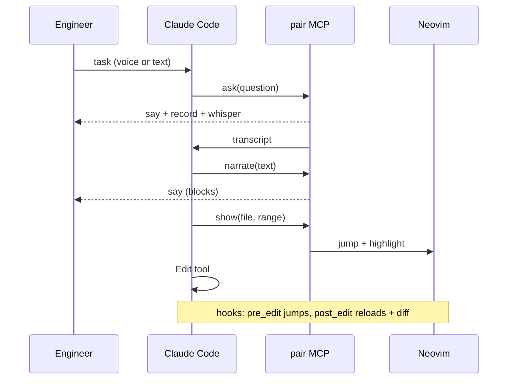
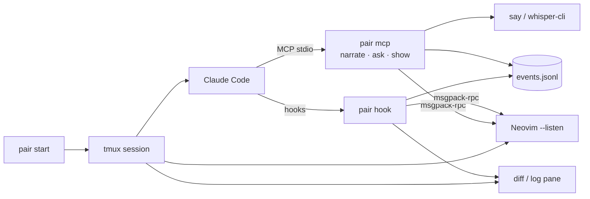

# PRD: pair — voice-driven pairing for Claude Code in the terminal

Sep 24, 2026 · @Fábio Araújo

## Overview

`pair` turns a Claude Code session into a spoken pairing session: Claude explains what it is about to do out loud, points at code in Neovim, asks questions and listens for the answer, while the engineer watches edits land live and can interrupt at any time.

**Problem.** Claude Code is a great executor but a silent one. Working with it feels like reviewing a pull request, not like pairing. Explanation lives in a scrolling text log, there is no pointing ("look at this line"), no live view of the files being edited, and every question requires typing.

**Approach.** Do not wrap or fork Claude Code. Orchestrate around it with pieces that already exist: tmux for layout, Claude Code hooks and MCP tools for events, Neovim's remote API for the live view, macOS `say` for speech and whisper.cpp for local speech-to-text. Everything runs locally, offline, and free.

**Why terminal-native.** It is the real Claude Code session with the user's real config and permissions, it works over SSH, and the engineer can take over in Neovim at any moment, which is closer to real pairing than a read-only web view.

**Non-goals for the project.** Real-time speech-to-speech with sub-second latency, a GUI, or replacing the human side of pairing (shared ownership, team knowledge).

## Goals and non-goals (v1)

v1 ships the full loop: narrate, show, ask, listen, interrupt, scratchpad and diff awareness, as an open-source tool another engineer can install in under 10 minutes.

**Goals**

1. Claude speaks a short rationale before every file edit and pauses until it has finished speaking.
2. Claude can point at a file range in Neovim without editing it.
3. Claude can ask a question aloud and receive the spoken answer as the tool result, within the same turn.
4. The engineer can talk to Claude (push-to-talk) and interrupt it mid-task with one hotkey.
5. Every edit is visible live in Neovim, with a diff view.
6. A shared scratchpad file (`PAIRING.md`) holds the plan, decisions and open questions; both sides edit it.
7. Claude is aware of edits the engineer made by hand since the last prompt.
8. Every event is logged as JSONL so a session can be replayed later.
9. One-command install and one-command session start.

**Non-goals**

- Sub-second voice latency or overlapping speech.
- Editors other than Neovim (VS Code and Zed are future work).
- Operating systems other than macOS (Linux TTS/STT is future work).
- Cloud TTS/STT by default. Providers must be swappable, but the default is free and local.
- Modifying Claude Code itself.

## Target users and prerequisites

The user is an engineer who already lives in Claude Code and Neovim on macOS and wants sessions to feel like pairing rather than delegating.

**Prerequisites**

| Dependency | Why | Install |
| --- | --- | --- |
| macOS 14+ (Apple Silicon recommended) | `say`, `afplay`, whisper.cpp Metal | — |
| Claude Code | the agent | `npm i -g @anthropic-ai/claude-code` |
| tmux 3.x | layout and pane control | `brew install tmux` |
| Neovim 0.10+ | live view via `--listen` | `brew install neovim` |
| whisper.cpp + a model | local STT | `brew install whisper-cpp` |
| sox | mic recording with silence detection | `brew install sox` |
| git-delta (optional) | pretty diffs | `brew install git-delta` |
| Hammerspoon (optional) | global hotkeys | `brew install --cask hammerspoon` |

No language runtime is required: `pair` is a single static Go binary (CLI, MCP server and hook handler in one).

Implementation language: Go. One binary, no runtime to install, sub-10 ms startup for hooks that fire on every edit, and a Homebrew bottle via goreleaser. The official MCP Go SDK (`github.com/modelcontextprotocol/go-sdk`) provides the stdio server.

## Session experience

A session starts with `pair` in a repo, and from then on the engineer mostly talks and watches.

1. `pair` opens tmux: Claude Code on the left, Neovim (file tree + editor + `PAIRING.md`) top right, diff/narration log bottom right.
2. The engineer speaks or types the task. Push-to-talk transcribes and sends it to the Claude pane.
3. Claude writes the plan and open questions to `PAIRING.md` before touching code.
4. For each decision point, Claude calls `ask`: the question is spoken, a chime plays, the mic records until silence, the transcript returns to Claude.
5. Before each edit, Claude calls `narrate` (spoken, blocking) and optionally `show` to highlight the range it is about to change.
6. The edit lands; Neovim reloads the file and the diff pane updates.
7. At any point the engineer presses the interrupt hotkey: speech stops, Claude Code receives Escape, push-to-talk opens.
8. The engineer can edit in Neovim directly; the next prompt automatically carries the resulting `git diff`.
9. Claude updates `PAIRING.md` with decisions taken. The JSONL log captures everything for replay.



Claude waits on every spoken step, so pacing comes from the blocking calls rather than from timers.

## Architecture

Five processes, one event log, no daemon: Claude Code is the only long-running agent, and everything else reacts to it through hooks, MCP tool calls and Neovim's socket.



**tmux layout** (session name `pair`, window 0):

| Pane | Content | Size |
| --- | --- | --- |
| 0 (left) | `claude` interactive | 50% width |
| 1 (top right) | `nvim --listen $PAIR_SOCK` with file tree, editor, `PAIRING.md` split | 70% height |
| 2 (bottom right) | `tail -f` of the narration log, rendered diffs via `delta` | 30% height |

**Data flow**

- Claude to screen: MCP `show` and the `PreToolUse` hook drive Neovim with `nvim --server $PAIR_SOCK --remote-send`.
- Claude to ears: MCP `narrate` and `ask` run `say` synchronously.
- Ears to Claude: `ask` records with `rec`, transcribes with `whisper-cli`, returns text; push-to-talk does the same and injects via `tmux send-keys -t pair:0.0`.
- Engineer edits to Claude: the `UserPromptSubmit` hook prepends `git diff` (bounded) to the prompt context.
- All of the above append one JSON line to `.pair/events.jsonl` per event: `{ts, type, payload}`.

**Runtime state** lives in `.pair/` inside the repo: `events.jsonl`, `PAIRING.md` (or at repo root; see open questions), `pair.sock` path, `last_input.wav`.

## Component specs

Six components, each small enough to build and test on its own.

### 1. `pair` CLI

- `pair` (or `pair start`): create the tmux session with the three panes, start `nvim --listen`, start `claude`, open `PAIRING.md`. Idempotent: attaches if the session exists.
- `pair init`: write `.claude/settings.json` hooks + permissions, register the MCP server (`claude mcp add pair -- pair mcp`), create `PAIRING.md` from a template, append the pairing-mode block to `CLAUDE.md` (guarded by markers so it can be updated or removed).
- `pair doctor`: check every dependency, the whisper model, mic permission, `say` voice availability.
- `pair replay [events.jsonl]`: replay a session (narration + jumps) at 1x or faster. Nice-to-have for v1.
- `pair stop`: kill the session and any running `say`/`rec`.

### 2. `pair mcp` (stdio MCP server, Go, official MCP Go SDK)

| Tool | Input | Behaviour | Returns |
| --- | --- | --- | --- |
| `narrate` | `text` | Log event, run `say` synchronously (blocks) | `"spoken"` |
| `ask` | `question` | `say` the question, play chime, `rec` until 1.5 s silence (max 60 s), `whisper-cli`, log both | transcript or `"(no answer)"` |
| `show` | `file`, `start_line`, `end_line?`, `note?` | Jump Neovim to the range, highlight it, optionally `narrate(note)` | `"shown"` |

Rules:

- Never record while `say` is running (echo). Calls are sequential by design; a mutex guards against parallel tool calls anyway.
- `narrate` rejects text over ~400 characters with a message telling Claude to shorten it. This keeps pacing tight.
- Voice, rate, language and model come from `PAIR_VOICE`, `PAIR_RATE`, `PAIR_LANG`, `PAIR_WHISPER_MODEL`.
- `Speaker` and `Listener` Go interfaces with `SayTTS` and `WhisperCPP` as default implementations, so cloud TTS/STT can be dropped in later.
- Registered with `claude mcp add pair -- pair mcp`; the same binary serves hooks and CLI.

### 3. Claude Code hooks (`.claude/settings.json`)

| Hook | Matcher | Command | Does |
| --- | --- | --- | --- |
| `PreToolUse` | `Edit\|MultiEdit\|Write` | `pair hook pre_edit` | Parse `tool_input`, locate `old_string` line, jump + highlight in Neovim, log. No audio (narration is the MCP tool's job). |
| `PostToolUse` | `Edit\|MultiEdit\|Write` | `pair hook post_edit` | `:checktime` in Neovim, render `git diff -- <file>` through `delta` into the log pane, log. |
| `UserPromptSubmit` | — | `pair hook prompt` | If `git diff` (working tree, bounded to ~200 lines) is non-empty since the last prompt, emit it as `additionalContext` prefixed "Engineer changed since last turn:". |
| `Stop` | — | `pair hook stop` | Chime + log turn end. |

Hooks read JSON on stdin, must exit 0, and finish in well under the hook timeout. They are subcommands of the same binary (`pair hook pre_edit`), so startup cost is negligible and there is one place to test.

### 4. Neovim integration (`pair.nvim`, Lua)

- Highlight group and namespace for "Claude is pointing here"; highlight clears on the next `show`, on edit, or after `PAIR_HIGHLIGHT_TTL` seconds.
- Exposes Lua functions `require('pair').show(file, s, e)` and `require('pair').reload()` so the Go binary drives the editor with one `nvim_exec_lua` call over msgpack-rpc instead of composing keystrokes.
- `autoread` + `checktime` on focus and on hook signal.
- Keymap `<leader>pp` (visual): send `file:start-end` + optional typed note to the Claude pane via `tmux send-keys`.
- Keymap `<leader>pt`: push-to-talk (`pair hook listen`).
- Keymap `<leader>pi`: interrupt (`pair hook interrupt`: kill `say`, send Escape, then listen).
- Command `:PairScratch` toggles the `PAIRING.md` split.
- Ships as a plugin directory usable with lazy.nvim; `pair init` prints the snippet.

### 5. Scratchpad (`PAIRING.md`)

Template sections: `Task`, `Plan`, `Decisions`, `Open questions`, `Notes`. `CLAUDE.md` instructs Claude to write the plan there before coding and to append to `Decisions` after every `ask`. Diagrams are ASCII or Mermaid fenced blocks. The file is git-ignored by default (`pair init` adds it), overridable.

### 6. Push-to-talk / interrupt (Hammerspoon, optional)

Global hotkeys that work even when the terminal is not focused: hold-to-record, and interrupt. They call the same `pair hook listen` / `pair hook interrupt` subcommands the Neovim keymaps use, so behaviour is identical.

## Voice

Default stack is macOS `say` for output and whisper.cpp for input: free, offline, and good enough for Portuguese with English technical terms.

**TTS (`say`)**

- Default voice `Luciana` (pt-BR), rate 190. `pair doctor` warns if the voice is missing and points to System Settings → Accessibility → Spoken Content to download a Premium/Siri voice.
- All speech goes through one `Speaker#speak(text)` call so it can be killed (`pkill say`) on interrupt and so a mutex can serialize it.
- Text is normalized before speaking: strip markdown, backticks and code; expand common abbreviations (`PR`, `DB`, `ActiveRecord`) via a small dictionary so they are not spelled letter by letter.

**STT (whisper.cpp)**

- Default model `ggml-large-v3-turbo` (about 1.6 GB); `pair doctor` offers to download it to `~/.pair/models/`. `small` as a low-end fallback.
- Recording: `rec -q -r 16000 -c 1 <wav> silence 1 0.1 1% 1 1.5 1%` with a hard cap (`timeout 60`). Silence threshold and trailing silence are configurable.
- Transcription: `whisper-cli -m <model> -l $PAIR_LANG -nt -np --prompt "<vocab>" -f <wav>`. The vocabulary prompt is built from a default Rails list plus `.pair/vocab.txt` in the repo, so project names and domain terms transcribe correctly.
- Empty or very short transcripts return `"(no answer)"` rather than guessing.

**Provider interface**

```go
type Speaker interface {
    Speak(ctx context.Context, text string) error // blocks until done; ctx cancel = interrupt
}

type Listener interface {
    Listen(ctx context.Context) (string, error) // records until silence, returns transcript
}
```

Adapters planned after v1: OpenAI TTS/STT, ElevenLabs, Apple SpeechAnalyzer (macOS 26+). Selection by `PAIR_TTS` / `PAIR_STT` env vars.

## Configuration and pairing-mode prompt

Configuration is env vars with sane defaults, plus a `CLAUDE.md` block that `pair init` manages.

| Variable | Default | Meaning |
| --- | --- | --- |
| `PAIR_VOICE` | `Luciana` | `say` voice |
| `PAIR_RATE` | `190` | words per minute |
| `PAIR_LANG` | `pt` | whisper language |
| `PAIR_WHISPER_MODEL` | `~/.pair/models/ggml-large-v3-turbo.bin` | model path |
| `PAIR_SOCK` | `.pair/nvim.sock` | Neovim listen socket |
| `PAIR_SESSION` | `pair` | tmux session name |
| `PAIR_HIGHLIGHT_TTL` | `20` | seconds before a `show` highlight clears |
| `PAIR_DIFF_LIMIT` | `200` | max diff lines injected by the prompt hook |
| `PAIR_ASK_MAX` | `60` | seconds of recording before `ask` gives up |
| `CLAUDE_CODE_MCP_AUTO_BACKGROUND_MS` | `0` | exported by `pair start`; disables Claude Code's 2-minute auto-backgrounding of MCP calls so `narrate`/`ask` always block |

Timeouts: Claude Code's default MCP tool timeout is about 28 hours and the stdio idle timeout is 30 minutes, so no override is needed. Since v2.1.212 a main-conversation MCP call still running after two minutes is moved to a background task, which would break pacing; `pair start` sets `CLAUDE_CODE_MCP_AUTO_BACKGROUND_MS=0` for the session so calls stay blocking. `PAIR_ASK_MAX` remains as a safety net.

`.claude/settings.json` written by `pair init`: the four hooks above, and `permissions.allow` for `mcp__pair__narrate`, `mcp__pair__ask`, `mcp__pair__show`.

**`CLAUDE.md` block** (between `<!-- pair:start -->` / `<!-- pair:end -->` markers):

```markdown
## Pairing mode
You are pairing live with an engineer. Rules:
- Before coding, write the plan and open questions to PAIRING.md.
- Before every file edit, call `narrate` with 1–2 spoken sentences: what you're changing and why. Plain speech, no markdown, no code.
- Use `show` to point at code you're discussing before you change it.
- When a decision is ambiguous, call `ask` instead of guessing. Record the answer in PAIRING.md under Decisions.
- Push back when you see a better approach; use `ask` for it.
- Speak Portuguese. Keep technical terms in English.
- Do not narrate trivial edits (imports, formatting); narrate intent, not diffs.
```

The language line is templated from `PAIR_LANG` at `pair init` time.

## Installation, distribution, repo layout

Distribute as a Homebrew formula plus a Neovim plugin; `brew install` then `pair init` inside a repo is the whole setup.

```
pair/
  cmd/pair/main.go        # single binary: start, init, doctor, replay, stop, mcp, hook <name>
  internal/cli/           # tmux session, init templates, doctor checks
  internal/mcp/           # narrate, ask, show tools (MCP Go SDK, stdio)
  internal/hook/          # pre_edit, post_edit, prompt, stop, listen, interrupt
  internal/speech/        # Speaker/Listener interfaces, say + whisper.cpp impls, text normalizer
  internal/nvim/          # remote client (msgpack-rpc or --remote-send)
  internal/events/        # JSONL log + replay
  nvim/                   # pair.nvim (lua/pair/init.lua, plugin/pair.lua)
  templates/              # PAIRING.md, settings.json, CLAUDE.md block, hammerspoon init.lua
  .goreleaser.yaml        # darwin arm64/amd64 builds + Homebrew tap
  README.md
```

- License: MIT.
- Distribution: goreleaser builds darwin arm64/amd64 and publishes to a Homebrew tap (`brew install <owner>/tap/pair`). The formula depends on tmux, neovim, sox, whisper-cpp; git-delta and hammerspoon are recommended, not required. `go install` works as a fallback.
- Neovim plugin installable from the same repo (`{ "<owner>/pair", ... }` in lazy.nvim with `rtp` set to `nvim/`), or a separate `pair.nvim` repo if that proves cleaner.
- Neovim control: prefer msgpack-rpc over the socket (`github.com/neovim/go-client/nvim`) for jumps and highlights, with `--remote-send` as a fallback; it avoids shelling out on every hook.
- README covers: the 60-second demo (asciinema), install, first session, hotkeys, swapping voices, and how to add a TTS/STT adapter.
- Tests: `go test` for text normalization, diff bounding, hook JSON parsing; integration test that runs `pair mcp` over stdio with fake `say`/`rec`/`whisper-cli` binaries on `PATH`.

## Milestones

Build in the order that gives a usable session soonest; each milestone is demoable on its own.

| # | Milestone | Scope | Done when |
| --- | --- | --- | --- |
| 1 | Skeleton | `pair start`, tmux layout, `nvim --listen`, `pre_edit` jump + highlight, `post_edit` reload | Watching Claude edit a file, the cursor follows |
| 2 | Voice out | `pair mcp` with `narrate` + `show`, `CLAUDE.md` block, `pair init` | Claude explains each edit aloud and pauses |
| 3 | Voice in | `ask`, push-to-talk, interrupt hotkey, whisper setup in `pair doctor` | A full task done without typing |
| 4 | Shared context | `PAIRING.md` template + keymaps, `UserPromptSubmit` diff hook, `<leader>pp` pointing | Claude reacts to hand edits and writes decisions |
| 5 | Ship | JSONL log, `pair replay`, diff pane with `delta`, Homebrew formula, README + demo | A stranger installs it in 10 minutes |

Milestone 1 is roughly a day; 1–3 together are a usable v0 for personal use before any packaging work.

## Risks, open questions, future work

The main risk is pacing: too much narration makes the session slower than typing, and the prompt rules plus the 400-character cap are the only guard.

**Risks**

| Risk | Mitigation |
| --- | --- |
| Claude narrates too much or too little | Prompt rules, character cap, `Stop` hook stats in the log to tune |
| `say` voices sound robotic and put people off | Recommend Premium voice in `doctor`; adapters for cloud TTS |
| Whisper mistranscribes jargon | Vocabulary prompt + `.pair/vocab.txt`; show the transcript in the log pane so errors are visible |
| MCP call auto-backgrounded after 2 min, breaking pacing | `pair start` exports `CLAUDE_CODE_MCP_AUTO_BACKGROUND_MS=0`; `pair doctor` warns if the user's env overrides it |
| `UserPromptSubmit` hook exceeds its timeout | Output is discarded silently on timeout, so bound `git diff` work and set an explicit `timeout` |
| Claude Code hook or MCP API changes | Thin adapter layer; pin tested Claude Code version in README |
| `neovim/go-client` is low-activity | API is stable and small; `--remote-send` fallback already specified |
| Mic permission for terminal apps | `pair doctor` triggers a test recording to prompt macOS once |

**Open questions**

- [ ] `PAIRING.md` at repo root or inside `.pair/`? Root is more visible; `.pair/` is tidier.
- [ ] Should `show` auto-narrate a default line ("olha aqui") when `note` is empty, or stay silent?
- [ ] Name: `pair` is generic and may collide on Homebrew. Alternatives to decide before publishing.

**Future work**

- Realtime speech-to-speech adapter (OpenAI Realtime / Gemini Live) for fluid conversation.
- MCP elicitation as a typed fallback for `ask` (the Claude Code CLI renders an inline form; the Desktop Code tab does not advertise elicitation, so it cannot be the only path).
- VS Code and Zed live views over the same event log.
- Linux support (Piper for TTS).
- Browser/app awareness via Playwright MCP so Claude can see what the engineer sees.
- Replay export as a narrated walkthrough for onboarding and PR explanations.

## Validation plan

Verified against current docs before build: hook events, stdin JSON and `additionalContext` output; MCP timeouts and the 2-minute auto-backgrounding (`CLAUDE_CODE_MCP_AUTO_BACKGROUND_MS`); the MCP Go SDK API (`mcp.NewServer` / `mcp.AddTool` / `mcp.StdioTransport`, v1.6+); `neovim/go-client` (`nvim.Dial`, `ExecLua`, extmarks); elicitation is CLI-only; `brew install whisper-cpp` providing `whisper-cli`. Everything else below is for Claude Code to validate with parallel subagents before milestone 1.

**Fan-out prompt for Claude Code**

```markdown
Read PRD.md. Spawn one subagent per item below, in parallel. Each subagent must
answer with: VERIFIED / WRONG / UNCERTAIN, evidence (command output or doc URL),
and the concrete change to the PRD if any. Do not build anything yet.

1. Hooks: run a throwaway PreToolUse hook on Edit and dump the stdin JSON.
   Confirm tool_input has file_path, old_string, new_string; confirm MultiEdit
   and Write shapes; confirm a blocking hook of 30s does not get killed with
   timeout: 120. Confirm UserPromptSubmit additionalContext reaches the model.
2. MCP: build a 30-line stdio server with github.com/modelcontextprotocol/go-sdk
   exposing a tool that sleeps N seconds. With
   CLAUDE_CODE_MCP_AUTO_BACKGROUND_MS=0, confirm a 150s call stays blocking.
   Confirm permissions.allow "mcp__pair__narrate" suppresses prompts. Confirm
   context cancellation reaches the handler when the user presses Escape.
3. Neovim: confirm github.com/neovim/go-client can Dial `nvim --listen <sock>`
   and call ExecLua into a plugin function that jumps + sets an extmark
   highlight; confirm `--remote-send` as fallback. Confirm autoread +
   :checktime reloads a file changed by another process without a prompt.
4. Audio: on this Mac, confirm `say -v Luciana` exists, `rec` silence
   detection stops after 1.5s, `whisper-cli` accepts -l pt -nt -np --prompt,
   and measure transcription time for 10s of audio with large-v3-turbo.
5. tmux: script the 3-pane layout and `send-keys` into the Claude pane;
   confirm Escape via send-keys interrupts a running Claude Code turn and
   what happens to an in-flight MCP call when it does.
6. Packaging: check Homebrew for name collisions on `pair`; confirm a
   goreleaser Homebrew tap formula can declare runtime deps on whisper-cpp,
   sox, tmux, neovim.
7. Prompt behaviour: run a small task with the CLAUDE.md pairing block and a
   narrate tool that only logs; count narrate calls per edit and average
   length. Report whether the 400-char cap is right.

Collect results into VALIDATION.md and list PRD sections to amend.
```

Expected outcome: a `VALIDATION.md` with one row per item and a short list of PRD edits, before any milestone work starts.
